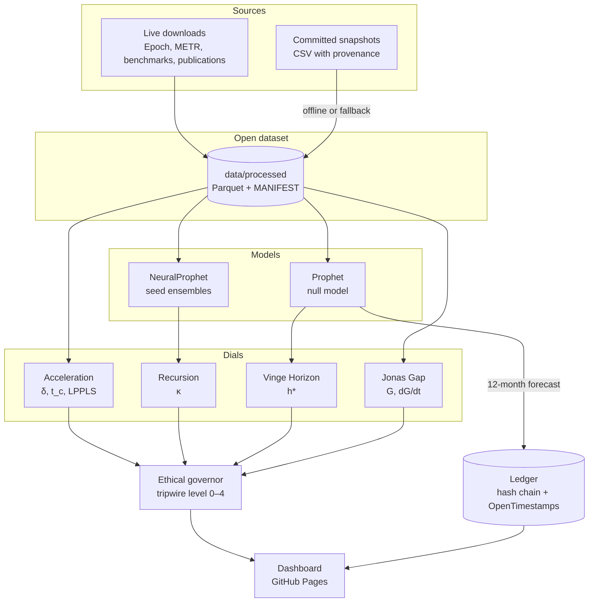
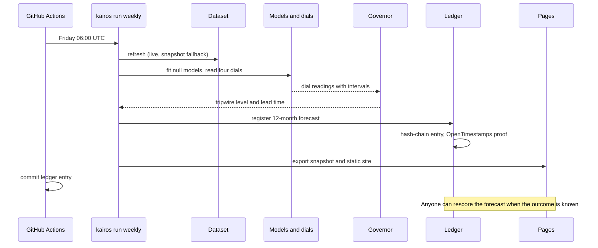

# KAIROS Observatory

**An open early-warning observatory for runaway AI: a seismograph for the intelligence explosion, built to be proven wrong.**

[](.github/workflows/ci.yml)
[](.github/workflows/weekly.yml)
[](https://github.com/guru-bharadwaj20/Kairos-Observatory/releases/tag/v0.1.0)
[](.python-version)
[](pyproject.toml)
[](LICENSE)
[](LICENSE-DATA)

KAIROS (Greek for *the decisive moment*) watches two curves, **what AI can do**,
`C(t)`, and **what humans can oversee**, `H(t)`, and answers one question every
week:

> **How much time is left while intervention is still cheap?**

Prophet and NeuralProphet model "normal" progress. Singularity detectors look for
super-exponential acceleration. A philosophy layer turns ethical principles into
decision rules with published parameters. Every forecast is hashed and
pre-registered so anyone can score it later. KAIROS is meant to be a
**self-defeating prophecy**: it succeeds when its warnings lead to the action that
proves them wrong.

**Live dashboard:** https://guru-bharadwaj20.github.io/Kairos-Observatory/

---

## Contents

| Section | |
|---|---|
| [What it does](#what-it-does) | The four dials, the governor, the ledger |
| [Architecture](#architecture) | How the pieces fit |
| [How a week travels](#how-a-week-travels) | Refresh, fit, dials, governor, ledger, export |
| [Quick start](#quick-start) | From clone to a weekly run |
| [Project status](#project-status) | Every phase, and what is still open |
| [Design decisions](#design-decisions) | The tradeoffs, and why |
| [Repository layout](#repository-layout) | Where things live |
| [Documentation](#documentation) | Which file answers which question |
| [Team](#team) | Who built it |

---

## What it does

### The four dials

| Dial | Symbol | What it measures | Danger sign |
|---|---|---|---|
| **Acceleration** | `δ`, `t_c` | Whether growth is super-exponential, and when it would blow up | `δ` significantly above 0 across independent metrics, `t_c` interval narrowing |
| **Recursion** | `κ` | How much AI progress is driven by AI itself | `κ` rising across rolling windows |
| **Vinge Horizon** | `h*` | How far ahead we can still predict | `h*` shrinking |
| **Jonas Gap** | `G`, `dG/dt` | Capability outrunning comprehension | `dG/dt > 0`, sustained |

### Tripwire levels

| Level | Trigger | Recommended response |
|---|---|---|
| **0: Normal** | All dials calm | Weekly publication |
| **1: Watch** | One dial in the danger zone | More data collection, public notice |
| **2: Warning** | Two dials, or one confirmed on 3+ independent metrics | Third-party evaluation before new frontier deployments |
| **3: Alarm** | Three dials | Pause scaling past the current frontier until `H` catches up |
| **4: Kairos** | All four dials | The last window in which intervention is still cheap |

**KAIROS recommends; humans decide.** It is an instrument, not a kill switch.

### By area

| Area | Capabilities |
|---|---|
| **Data** | 23 open series for `C(t)` and `H(t)`, an event calendar, data vintages and a hashed manifest |
| **Null models** | Prophet on `ln y` with changepoint analysis; NeuralProphet seed ensembles with a permutation null |
| **Singularity math** | Hyperbolic `δ` fit, `t_c`, moving block bootstrap, LPPLS grid search on the GPU with a float64 CPU reference |
| **Governor** | Jonas asymmetric loss, Rawls maximin, Collingridge lead time, Goodhart divergence, Löb independence check |
| **Validation** | Backtests on world population, dot-com, Bitcoin 2017, COVID-19, Moore's law and AI changepoints |
| **Ledger** | SHA-256 hash-chained JSONL, OpenTimestamps anchoring to Bitcoin, calibration and CRPS scorecard |
| **Dashboard** | Streamlit app plus a static HTML export published to GitHub Pages every week |

---

## Architecture

Data flows one way: from sources, through models and dials, into a governor, and
out to a ledger and a dashboard. Nothing downstream can edit what came before it.



The CPU does the many small Prophet/Stan fits through a 28-worker process pool.
The GPU takes the wide, batched float32 work: LPPLS grids, bootstraps and
NeuralProphet ensembles. Every GPU kernel has a float64 CPU reference and an
equivalence test.

---

## How a week travels



A forecast that has been registered can never be edited. Corrections are new
entries that name the hash of the entry they replace.

---

## Quick start

KAIROS pins **Python 3.12** (NeuralProphet 0.9 does not support 3.13) and uses
[uv](https://docs.astral.sh/uv/).

```bash
# 1 — the repo
git clone https://github.com/guru-bharadwaj20/Kairos-Observatory.git
cd Kairos-Observatory

# 2 — the environment
uv python install 3.12
uv sync --all-extras              # CUDA torch on Windows/Linux

# 3 — check the machine
uv run kairos doctor              # CPU, RAM, CUDA, CmdStan

# 4 — the fast test suite
uv run pytest -m "not slow and not gpu"

# 5 — one full weekly run
uv run kairos run weekly --cpu-only
#   KAIROS_OFFLINE=1 uses the committed snapshots and skips timestamping

# 6 — look at it
uv run kairos dashboard           # or open build/site/index.html
```

Configuration comes from `KAIROS_*` environment variables (for example
`KAIROS_N_JOBS=8`, `KAIROS_DEVICE=cpu`) or a `kairos.yaml` file. Every
subcommand is listed by `uv run kairos --help`.

The v0.1.0 wheel is attached to the
[GitHub release](https://github.com/guru-bharadwaj20/Kairos-Observatory/releases/tag/v0.1.0),
or install straight from git:

```bash
pip install git+https://github.com/guru-bharadwaj20/Kairos-Observatory@v0.1.0
```

---

## Project status

All 13 phases and 137 subtasks are complete. Each subtask landed as one commit.

```mermaid
gantt
    title Delivery — all phases complete
    dateFormat X
    axisFormat %s
    section Foundation
    Phase 0 · tooling, governance, CI               :done, 0, 1
    Phase 1 · compute layer CPU/GPU                 :done, 1, 2
    Phase 2 · open dataset C(t), H(t), events       :done, 2, 3
    section Models
    Phase 3 · Prophet null models                   :done, 3, 4
    Phase 4 · NeuralProphet and κ                   :done, 4, 5
    section Dials
    Phase 5 · δ, t_c, LPPLS                         :done, 5, 6
    Phase 6 · Vinge Horizon h*                      :done, 6, 7
    Phase 7 · Jonas Gap G, dG/dt                    :done, 7, 8
    section Judgement
    Phase 8 · ethical governor, tripwires           :done, 8, 9
    Phase 9 · historical validation                 :done, 9, 10
    section Publication
    Phase 10 · pre-registration ledger              :done, 10, 11
    Phase 11 · public dashboard                     :done, 11, 12
    Phase 12 · automation, release, paper           :done, 12, 13
```



| Phase | Scope | Subtasks |
|:-:|---|:-:|
| 0 | Foundation and governance | ✅ 14/14 |
| 1 | Compute layer (CPU/GPU) | ✅ 8/8 |
| 2 | Open dataset: `C(t)`, `H(t)`, events | ✅ 23/23 |
| 3 | Prophet null models | ✅ 10/10 |
| 4 | NeuralProphet and the recursion dial `κ` | ✅ 12/12 |
| 5 | Singularity math: `δ`, `t_c`, LPPLS | ✅ 14/14 |
| 6 | Vinge Horizon `h*` | ✅ 7/7 |
| 7 | Jonas Gap `G`, `dG/dt` | ✅ 6/6 |
| 8 | Ethical governor and tripwires | ✅ 9/9 |
| 9 | Historical validation | ✅ 9/9 |
| 10 | Pre-registration ledger | ✅ 7/7 |
| 11 | Public dashboard | ✅ 9/9 |
| 12 | Automation, release, paper | ✅ 9/9 |
| | **Total** | **137/137** |

**What is still open:**

| # | Item | Why it is not closed |
|---|---|---|
| 1 | Self-hosted GPU runner | Hardware, not code. The `gpu` workflow is written and waits for a runner labelled `kairos` ([docs/runner.md](docs/runner.md)) |
| 2 | PyPI publishing | Deferred. Releases go to GitHub; a PyPI job can be added back once a trusted publisher exists |
| 3 | `δ` bootstrap coverage | Measures 0.68–0.87 against a 0.90 target on synthetic data |
| 4 | First-run governor | With no history, the governor reports level 0 even when one dial reads high |
| 5 | Interval coverage in validation | `scoring.interval_coverage` exists but no backtest case calls it yet |
| 6 | Hand-curated inputs | Some series are read from published charts and are approximate; the CSVs say so |

### What CI proves on every push

| Job | Proves |
|---|---|
| `CI` · Ubuntu and Windows | ruff, `mypy --strict` and the fast test suite (778 tests) |
| `CI` · citation | `CITATION.cff` is valid |
| `docs` | The MkDocs site builds and deploys to GitHub Pages |
| `paper` | The LaTeX paper compiles |
| `weekly` | The full pipeline runs on live data every Friday and commits its ledger entry |
| `gpu` | GPU tests, slow backtests and a GPU weekly run (self-hosted runner) |
| `release` | A tag matches the package version and changelog, then builds and publishes a GitHub release |

---

## Design decisions

**Out-of-sample or nothing.** Every dial is scored on data the model never saw.
Backtests use only the data vintage available at each cutoff, so no lookahead can
make a detector look better than it is.

**`δ` from history, not from the forecast.** Prophet's trend is piecewise linear
in `ln x`, so differentiating it gives a step function that hides acceleration.
`δ` comes from a smoothed derivative of historical data, cross-checked with a
direct hyperbolic fit (design note D1).

**Errors in log units.** MAPE on `ln(FLOP)` is meaningless: a 25% error on a log
value is a factor of about e¹⁴. The Vinge Horizon uses absolute log error and
CRPS, with a tolerance stated as a factor (D2).

**`κ` against chance.** About 200 monthly points are easy to overfit. `κ` is
reported against a permutation null of shuffled self-lags, from seed ensembles
with early stopping (D9).

**Published parameters.** `λ` and every tripwire threshold live in versioned
YAML, never as literals in code. Change the YAML and the change is public.

**Git history is not proof.** History can be rewritten, so the ledger is a
hash chain anchored to Bitcoin through OpenTimestamps (D11).

**Recommend, never act.** The governor outputs a level and a recommended
response. Whether anyone acts on it is a human decision.

The full set of notes, D1–D12, is in [docs/design.md](docs/design.md).

---

## Repository layout

```
.
├── src/kairos/      the package: data, models, neural, accel, vinge, jonas,
│                    tripwires, philosophy, validation, ledger, dashboard, commands
├── tests/           pytest suite (markers: slow, gpu)
├── data/            the open dataset: raw snapshots, processed Parquet, MANIFEST
├── ledger/          forecasts.jsonl and OpenTimestamps proofs
├── docs/            MkDocs site: methodology, dials, governor, runbooks
├── notebooks/       null model, singularity detectors, reading the clock
├── paper/           LaTeX paper, results filled from the published runs
├── docker/          CUDA replication container for the validation report
└── scripts/         hardware benchmarks
```

---

## Documentation

| Question | File |
|---|---|
| *What is the idea?* | [KAIROS_Project_Idea.md](KAIROS_Project_Idea.md) |
| *How does it work, for a general reader?* | [docs/methodology.md](docs/methodology.md) |
| *Why was it built this way?* | [docs/design.md](docs/design.md) — non-negotiables, hardware plan, D1–D12 |
| *Where does the data come from?* | [docs/data.md](docs/data.md) |
| *How is each dial computed?* | [docs/acceleration.md](docs/acceleration.md) · [docs/neural.md](docs/neural.md) · [docs/vinge.md](docs/vinge.md) · [docs/jonas.md](docs/jonas.md) |
| *How is a level decided?* | [docs/governor.md](docs/governor.md) |
| *Does it work on history?* | [docs/validation.md](docs/validation.md) |
| *How do I check a forecast?* | [docs/ledger.md](docs/ledger.md) |
| *What does the weekly run do?* | [docs/weekly.md](docs/weekly.md) |
| *How fast is the hardware?* | [docs/benchmarks.md](docs/benchmarks.md) |
| *Who decides what?* | [GOVERNANCE.md](GOVERNANCE.md) |
| *What changed?* | [CHANGELOG.md](CHANGELOG.md) |

---

## The rule that cannot be broken

> [!CAUTION]
> **Never edit or delete a ledger entry.** Each entry's hash is part of the next
> one, and each is anchored to Bitcoin. Changing one line breaks every entry after
> it, and `kairos ledger verify` will say so. Corrections are new entries that
> name the hash they supersede.

---

## Team

| Member | Focus |
|---|---|
| **Guru R Bharadwaj** | Design, models, dials, governor, ledger, dashboard, automation |

---

## Licence

Code is licensed under [Apache-2.0](LICENSE). KAIROS-built datasets and published
forecasts are licensed under [CC BY 4.0](LICENSE-DATA). Third-party data keeps
its original licence. To cite KAIROS, see [CITATION.cff](CITATION.cff).
