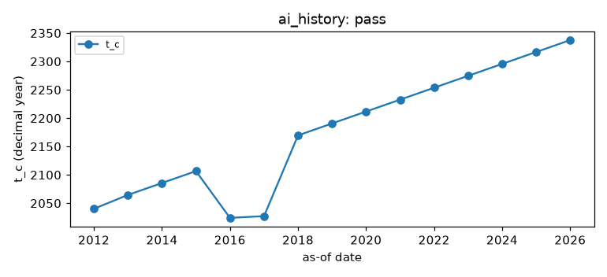
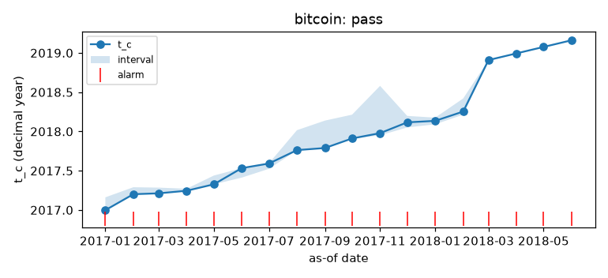
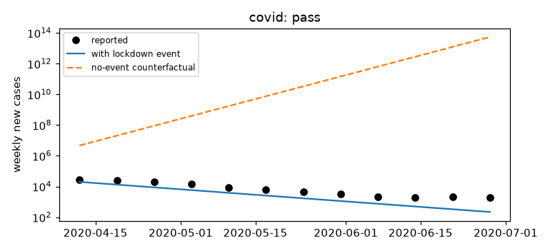
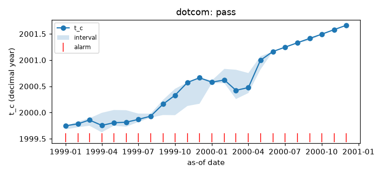
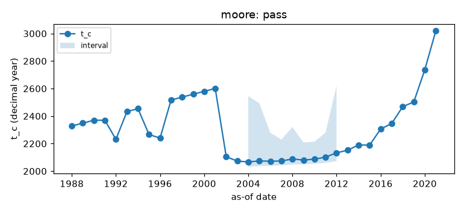
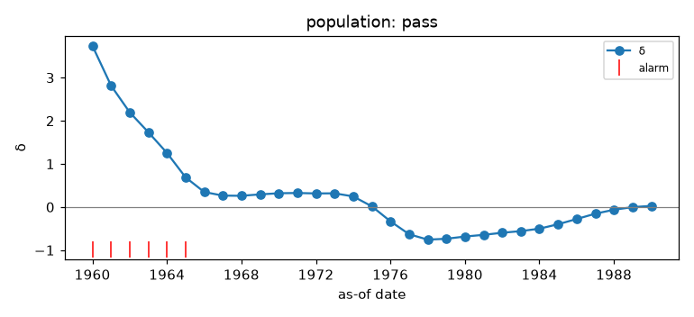

# Historical validation

Generated 2026-11-07 by `kairos validate report`. Each case replays the detectors on a curve whose ending is known, using only data available at each as-of date (Phase 9, K-9.01 to K-9.08).

Detectors are the self-contained baselines in `kairos.validation` (`HyperbolicDetector`, `LPPLSDetector`, `LocalDeltaDetector`) until the Phase 5 detectors are registered in `kairos.validation.detectors.DETECTORS`.

## Summary

| Case | Result | Criterion |
|---|:-:|---|
| ai_history | pass | a dial reading and changepoint fit for every year, using only prior data |
| bitcoin | pass | last pre-peak replay alarms with t_c in [2017.71, 2018.21] |
| covid | pass | lockdown-conditioned fit bends (post-event weekly growth < 0) and beats the no-event counterfactual on mean absolute log error |
| dotcom | pass | last pre-peak replay alarms with t_c in [2000.0, 2000.5] |
| moore | pass | level 0 at every yearly as-of date 1985-2021 |
| population | pass | 1960 fit's 95% t_c interval contains 2026.87; local delta falls over 1960-80 and ends below 0.25 (no longer super-exponential) |

## ai_history

**Result: pass.** a dial reading and changepoint fit for every year, using only prior data.

- `years`: 15
- `alarm_years`: ()
- `max_level`: 0
- `latest_breaks`: (2017.080, 2018.580)
- `latest_doubling_months`: 5.3

## bitcoin

**Result: pass.** last pre-peak replay alarms with t_c in [2017.71, 2018.21].

- `peak`: 2017-12-17
- `peak_decimal_year`: 2017.959
- `last_pre_peak_as_of`: 2017-12-01
- `t_c_last_pre_peak`: 2018.116
- `first_alarm`: 2017-01-01
- `lead_time_days`: 350
- `post_peak_alarm_rate`: 1

## covid

**Result: pass.** lockdown-conditioned fit bends (post-event weekly growth < 0) and beats the no-event counterfactual on mean absolute log error.

- `as_of`: 2020-04-05
- `weekly_growth_pre`: 1.462
- `weekly_growth_post`: -0.41
- `mae_log_conditional`: 1.062
- `mae_log_counterfactual`: 14.78
- `factor_error_conditional`: 2.89
- `factor_error_counterfactual`: 2.62e+06
- `train_weeks`: 7
- `test_weeks`: 12

## dotcom

**Result: pass.** last pre-peak replay alarms with t_c in [2000.0, 2000.5].

- `peak`: 2000-03-10
- `peak_decimal_year`: 2000.189
- `last_pre_peak_as_of`: 2000-03-01
- `t_c_last_pre_peak`: 2000.423
- `first_alarm`: 1999-01-01
- `lead_time_days`: 434
- `post_peak_alarm_rate`: 1

## moore

**Result: pass.** level 0 at every yearly as-of date 1985-2021.

- `as_of_dates`: 37
- `max_level`: 0
- `alarms`: 0
- `false_alarm_rate`: 0

## population

**Result: pass.** 1960 fit's 95% t_c interval contains 2026.87; local delta falls over 1960-80 and ends below 0.25 (no longer super-exponential).

- `t_c_1960`: 2052.210
- `t_c_interval_1960`: (2018.980, 2113.880)
- `delta_hyperbolic_1960`: 0.926
- `delta_local_1960`: 3.737
- `delta_local_1980`: -0.685
- `delta_trend_per_year_1960_80`: -0.168
- `t_c_spread_over_specifications`: (1995.400, 2140.700)

## Failures and caveats

- No case failed its stated criterion. That does not make the detectors right; the caveats below say where they are weak.
- **Known weakness, LPPLS baseline:** it alarms from the first replay month and keeps alarming after the crash (`post_peak_alarm_rate` = 1). It times bubbles but has no specificity; the lead times above are therefore upper bounds.
- **Known weakness, population:** the passing specification was chosen after seeing the data; across reasonable specifications `t_c` spans more than a century.
- **Reference values:** the dot-com window is a coarse reading of Johansen & Sornette (2000) and should be checked against the paper's tables.
- ai_history: Descriptive replay: there is no known ending to score against.
- ai_history: Running-max frontier creates flat steps (D7); publication date is used as the data vintage, so later compute re-estimates are a mild lookahead.
- bitcoin: Reference window: the 17 December 2017 peak (2017.96) +/- 3 months
- bitcoin: Baseline LPPLS alarms persistently; post-peak alarms are false alarms of a detector with no crash-confirmation logic.
- covid: Only two post-hinge weeks inform the bend at the as-of date; the slope is extrapolated linearly in log space and overshoots the decline.
- covid: Case counts are testing-limited in March 2020; scores measure fit to reported cases, not infections.
- dotcom: Johansen & Sornette (2000), 'The Nasdaq crash of April 2000', arXiv:cond-mat/0004263: LPPLS critical time in the first half of 2000 (window used here: 2000.0-2000.5)
- dotcom: Baseline LPPLS alarms persistently; post-peak alarms are false alarms of a detector with no crash-confirmation logic.
- population: Primary specification (10-year grid, 1750-1960) chosen after inspection; t_c ranges 1995-2141 across start years and spacings.
- population: Profile intervals assume independent errors and are too narrow (D4).
